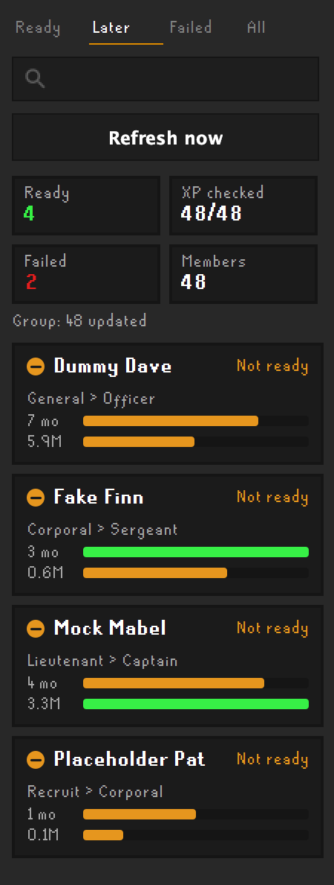
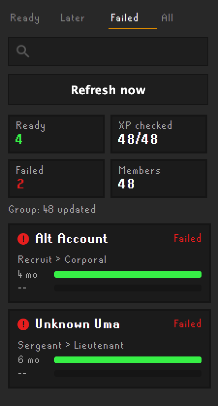

# Clan Promotion Helper

A RuneLite plugin for clan leaders. It works out which clan members are due a promotion from how long they've been in the clan and how much XP they've gained since joining, then lists them in an on-screen panel and a sidebar, and highlights them in the Clan Settings member list.

## Screenshots

The sidebar lists everyone due a promotion, with progress towards each requirement. The members shown are made up. In game, each name has the member's clan rank icon beside it in place of the round status icon used in these pictures.

| Ready | Later | Failed |
|---|---|---|
|  |  |  |

## How it works

1. **Roster.** When you log in, the plugin reads your clan's members, ranks and join dates straight from the game. Nothing needs exporting.
2. **XP.** If you turn on Wise Old Man lookups, it fetches each member's overall XP gained since their join date from [wiseoldman.net](https://wiseoldman.net), one member at a time in the background.
3. **Promotions.** Each member is checked against your rank requirements. A member qualifies for their **next** rank once they have both the months in the clan and the XP it needs.

A month counts once its join day arrives. For example, someone who joined on the 25th has 2 months on the 25th two months later, not on the 24th.

## Setup

Open the plugin's settings:

1. **Look up XP on Wise Old Man:** turn this on. It's off by default because it sends requests to a third-party site.
2. **Contact name:** your Discord or in-game name. It's sent with each lookup so Wise Old Man can reach you about your usage.
3. **API key** (optional): raises Wise Old Man's limit from 20 to 100 lookups a minute. Ask for one on the [Wise Old Man Discord](https://wiseoldman.net/discord).
4. **Rank requirements:** check the table matches your clan (see below).

The panel shows progress while XP is being checked. A clan of about 500 members takes around 28 minutes without an API key and about 6 minutes with one. Results are saved per account, and members are only looked up again after the refresh interval (6 hours by default), so later logins are quick.

### Faster refreshes with a Wise Old Man group (optional)

If your clan has a [Wise Old Man group](https://wiseoldman.net/groups), enter its ID in **Wise Old Man group ID** (the number at the end of the group's web address). Leave it at 0 to skip this.

- The **first fill is unchanged**: one lookup per member. While looking each one up, the plugin saves their total XP at their join date.
- After that, a refresh is **one request for the whole group**. Each member's XP gained is their current total minus the saved starting XP.
- Anyone the group can't answer for, such as a member who isn't in the group yet or whose total is missing, is still looked up individually.
- If the group request fails (for example a wrong ID, or a rate limit), the plugin falls back to looking members up one by one and shows the reason in the sidebar (hover the line for the full text).

## Sidebar

Click the plugin's icon in RuneLite's sidebar for a list of every clan member:

- **Status:** Ready (with the rank they're due), Not ready, Waiting for XP, Lookup failed, Ignored, Rank not in table, or Top rank.
- **Rank icon:** each member's current clan rank icon, taken from the game, appears beside their name. A coloured status dot shows instead until RuneLite has loaded the icons.
- **Details:** their current rank and the next one, months in the clan and XP gained.
- **Last checked:** the Ready tab shows when XP was last looked up (hover for the oldest result).
- **Tabs and search:** Ready, Later (not ready yet), Failed (lookups that failed) and All, plus a name search. Up to 200 rows are drawn at once; use the search box to narrow a larger clan.
- Hover a failed row to see why the lookup failed.
- **Opens on "Ready"**, so you see who to promote first. Use the "All" tab for everyone.
- **Refresh now:** re-checks XP straight away instead of waiting for the refresh interval. With a Wise Old Man group ID set, it refreshes everyone with one request. Without one, it only retries members with no result yet or a failed lookup, so it doesn't send hundreds of requests; the rest refresh on the normal interval. It's disabled while a refresh is running and has a one-minute cooldown.

## Rank requirements

One rank per line, lowest first, as `Rank:months:XP in millions`:

```
Thief:0:0
Recruit:1:0.1
Corporal:2:0.5
Sergeant:3:1
Lieutenant:4:2
Captain:5:3
General:6:8
Officer:9:12
Commander:12:20
Colonel:15:25
Brigadier:17:30
Admiral:20:50
Marshal:24:75
```

The table above is an example ladder. Replace it with your clan's own rank titles and requirements; if a title doesn't match, those members show "Rank not in table" and are never suggested. Ranks such as Owner or Deputy Owner are normally left out of the table, so they are never suggested either.

## Display settings

- **Show promotions panel:** the on-screen list of members due a promotion. It only appears while someone is due, and does not list failed lookups; the sidebar always shows everyone, including failures.
- **Highlight in member list:** highlights them in Clan Settings → Members.
- **Highlight colour**, **Max shown in panel**.
- **Ignored players**, **Ignored target ranks:** comma-separated lists to leave out.

## Privacy

Wise Old Man lookups are **off by default**. When you turn them on, the plugin sends these things to [wiseoldman.net](https://wiseoldman.net), and nothing else to any server:

- each clan member's **name** and the **date they joined**, so Wise Old Man can say how much XP they gained since then (one request per member, or one request for the whole group if you set a group ID);
- your **contact name**, if you entered one, in the request's User-Agent header;
- your **API key**, if you entered one.

Like any web request, this also shows your IP address to Wise Old Man. Results are saved only on your own computer, in RuneLite's settings, and the plugin never changes anything on Wise Old Man: it only reads. The data comes from the clan list the game already shows you.

## Notes

- If a lookup fails, for example because the player isn't tracked on Wise Old Man, it counts under "Lookups failed". That member is never treated as having 0 XP, and is tried again after the refresh interval.
- XP gained only counts from when Wise Old Man first tracked the player, so members who were never tracked before joining may show less than they really gained.

## Credits

The member-list highlighting follows the approach of the [Clan Rank Helper](https://github.com/homer2011/clan-rank-helper) plugin (BSD-2).
