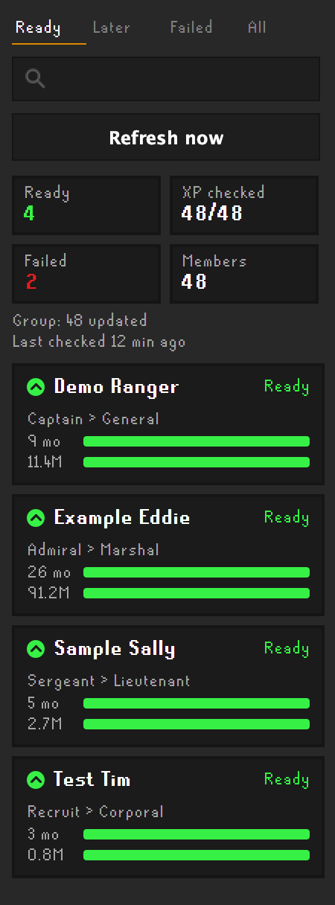

# Clan Promotion Helper

A RuneLite plugin that helps clan leaders identify members who are ready for promotion. It compares each member's time in the clan and XP gained against your clan's rank requirements, then lists eligible members in a sidebar and on-screen panel and highlights them in the Clan Settings member list.



## Features

- Automatically reads clan members, ranks and join dates from the game.

- Tracks XP gained using optional [wiseoldman.net](https://wiseoldman.net) lookups.

- Highlights members who meet the requirements for their next rank.

- Supports custom rank ladders to match your clan's promotion system.

- Caches results locally to make subsequent checks faster.

## Setup

In the plugin's settings:

1. **Look up XP on Wise Old Man:** turn this on. It's off by default because it sends requests to a third-party site.
2. **Contact name:** your Discord name. It's sent with each lookup so Wise Old Man can reach you if needed about your usage.
3. **API key** (optional): raises Wise Old Man's limit from 20 to 100 lookups a minute. Ask for one on the [Wise Old Man Discord](https://wiseoldman.net/discord).
4. **Rank requirements:** check the table below matches your clan, or set it up with **Edit ranks** in the sidebar.
5. **Wise Old Man group ID** (optional): if your clan has a [group](https://wiseoldman.net/groups), enter its ID (the number at the end of its web address). After the first fill, a refresh then takes one request for the whole group instead of one per member. If the group request fails, the plugin falls back to looking members up one by one.

A clan of about 500 members takes around 28 minutes to check without an API key and about 6 minutes with one. Results are saved per account and refreshed once a day, the first time you log in that day, so later logins are quick. Members whose rank isn't in your rank table (such as staff) and members at the top rank can't be promoted, so they aren't looked up.

## Sidebar

Click the plugin's icon in RuneLite's sidebar:

- Tabs for **Ready**, **Later** (not ready yet), **Failed** and **All**, plus a name search.
- The list of members is limited to 200 results so you may need to use the search function to find specific members in larger clans.
- Each member shows their rank, months in the clan, XP gained and progress towards the next rank.
- **Refresh now** re-checks XP straight away and can be used once an hour. With a group ID set it refreshes everyone with one request; without one it only retries members with no result or a failed lookup.
- **Edit ranks** opens an editor for the rank ladder: add, remove and reorder ranks and set each one's months and XP. **Fill from clan** lists your clan's in-game ranks in order and keeps the requirements you've already set. Nothing changes until you press Save.

## Rank requirements

Use **Edit ranks** in the sidebar, or type one rank per line in the settings, lowest first, as `Rank:months:XP in millions`. This is an example ladder; replace it with your clan's own rank titles and requirements:

```
Thief:0:0
Recruit:1:1
Corporal:2:2
Sergeant:3:3
Lieutenant:4:4
Captain:5:5
General:6:8
Officer:9:12
Commander:12:20
Colonel:15:25
Brigadier:17:30
Admiral:20:50
Marshal:24:75
```

If a title doesn't match, those members show "Rank not in table" and are never suggested. Leave out ranks you don't promote to, such as Owner.

## Privacy

Wise Old Man lookups are **off by default**. When you turn them on, the plugin sends only these things, and only to [wiseoldman.net](https://wiseoldman.net):

- each clan member's **name** and **join date**, so Wise Old Man can say how much XP they gained since then;
- your **contact name** and **API key**, if you entered them.

Like any web request, this shows your IP address to Wise Old Man. Results are saved only on your own computer, and the plugin never changes anything on Wise Old Man: it only reads.

## Notes

- A failed lookup, for example for a player Wise Old Man doesn't track, is never treated as 0 XP. It shows under Failed and is retried at the next day's first login, or with Refresh now.
- XP gained only counts from when Wise Old Man first tracked the player, so members who weren't tracked before joining may show less than they really gained.

## Credits

The member-list highlighting follows the approach of the [Clan Rank Helper](https://github.com/homer2011/clan-rank-helper) plugin (BSD-2).

The rank editor is adapted from one contributed by [ItsMajorSpace](https://github.com/ItsMajorSpace) in [pull request #1](https://github.com/GhostedZero/clan-promotion-helper/pull/1).
